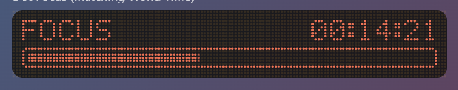
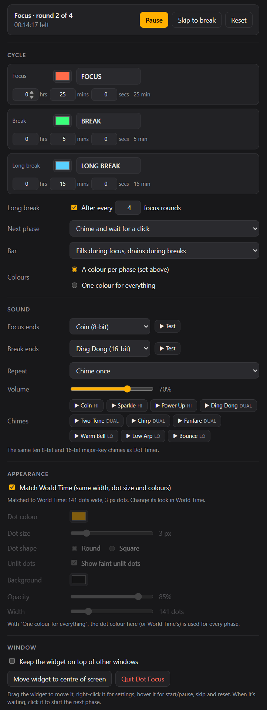

# Dot Focus

A lightweight focus-cycle (Pomodoro-style) widget for Windows and macOS. A single dot-matrix block shows the current phase, the time left and a loading bar.

## What it does

- **Focus and break, on repeat.** Set the length of each phase in hours, minutes and seconds. The defaults are 25 min focus and 5 min break.
- **Optional long break.** Every few focus rounds (4 by default) you get a long break instead (15 min by default). You can turn it off.
- **Your choice of what happens next.** When a phase ends it chimes, then either:
  - waits for you to click the widget, or
  - starts the next phase automatically.
- **Bar direction.** Choose one of:
  - fills during focus and drains during breaks
  - the other way round
  - always fills
  - always drains
- **Colours.** Use a colour per phase (focus, break, long break), or one colour for everything.
- **The same ten chiptune chimes as Dot Timer.** Pick one for when focus ends and one for when a break ends. Each can play once or repeat until clicked.
- **Fits with World Time.** It matches World Time's width, dot size and colours. It's one fixed-size block, the same as a Dot Timer row.
- **Keeps going while closed.** In automatic mode, it works out which phase you'd be in when you reopen it.

## Using it

| Action | How |
|---|---|
| Start, pause, skip or reset | Hover over the widget: ▶/⏸, ⏭ and ↺ sit on the right of the bar |
| Start the next phase (wait mode) | Click the widget |
| Silence a chime | Click the widget |
| Settings | Right-click the widget, or hover and click ⚙ |
| Move it | Drag the widget |

## How it works

Dot Focus is built with [Tauri](https://tauri.app), like the others: a small Rust program around your system's own web view.

- **Shared code.** The display, chimes and World Time matching are the same code as Dot Timer.
- **Offline.** It never connects to the internet.
- **Local settings.** Settings are saved to a small file on your computer.

## Building it yourself

See [BUILDING.md](BUILDING.md). The steps are the same as Dot Timer's; the installer is called `Dot Focus_1.0.0_x64_en-US.msi`.

## Check out the Singular Widgets

[Dot Calendar](https://github.com/slainbya-dotcom/dot-Calendar)
[Dot Clipboard](https://github.com/slainbya-dotcom/dot-clipboard)
[Dot Clock](https://github.com/slainbya-dotcom/dot-clock)
[Dot Deck](https://github.com/slainbya-dotcom/dot-deck)
[Dot Dice](https://github.com/slainbya-dotcom/dot-dice)
[Dot Focus](https://github.com/slainbya-dotcom/dot-focus)
[Dot Launcher](https://github.com/slainbya-dotcom/dot-launcher)
[Dot List](https://github.com/slainbya-dotcom/dot-list)
[Dot Planner](https://github.com/slainbya-dotcom/dot-planner)
[Dot Player](https://github.com/slainbya-dotcom/dot-player)
[Dot Reader](https://github.com/slainbya-dotcom/dot-reader)
[Dot Sun](https://github.com/slainbya-dotcom/dot-sun)
[Dot System](https://github.com/slainbya-dotcom/dot-system)
[Dot Ticker](https://github.com/slainbya-dotcom/dot-ticker)
[Dot Timer](https://github.com/slainbya-dotcom/dot-timer)
[Dot Visualiser](https://github.com/slainbya-dotcom/dot-visualiser)
[Dot Weather](https://github.com/slainbya-dotcom/dot-weather)